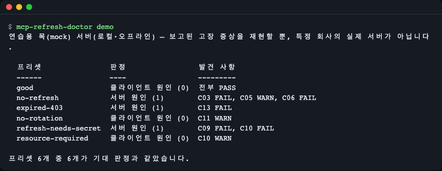
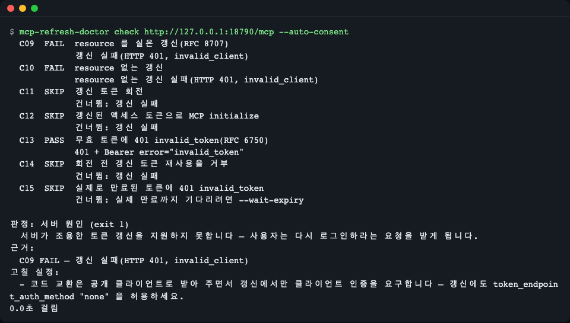
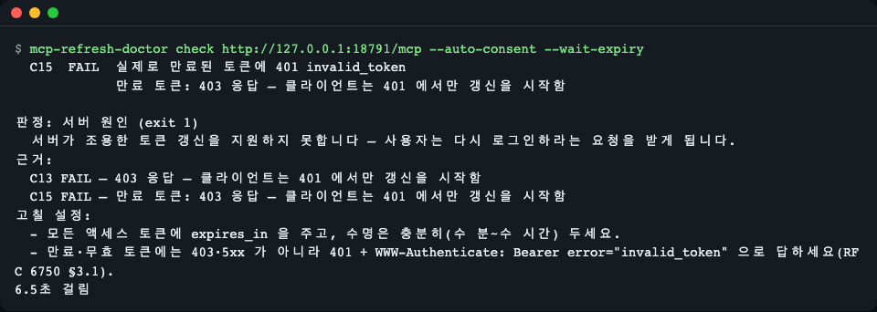
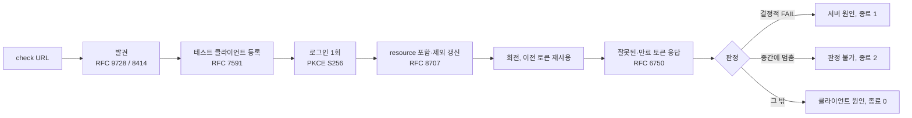

# mcp-refresh-doctor

[English](README.md) | **한국어**

원격 MCP 서버가 왜 자꾸 다시 로그인하라고 하는지 알아내는 도구입니다. `mcp-refresh-doctor` 는 서버에 OAuth 2.1 토큰 수명주기(발급·갱신·회전·재사용·만료)를 실제로 돌려 보고, 원인이 서버 쪽인지 클라이언트 쪽인지 판정합니다. 런타임 의존성이 없는 TypeScript CLI 입니다.


*`demo` 는 고장을 하나씩 일부러 넣은 연습용 목(mock) 서버 6개를 오프라인으로 점검하고 판정을 보여 줍니다.*

## 이런 분께
- 원격 MCP 서버를 운영하는데 사용자가 "한두 시간(또는 하루)마다 다시 로그인하라고 나온다"고 합니다.
- 그런 서버의 지원을 맡아서 버그 리포트에 붙일 근거(JSON 리포트)가 필요합니다.
- MCP 클라이언트를 만들고 있고, 갱신 처리를 오프라인에서 시험할 고장 주입 가짜 서버가 필요합니다.

## 설치

전제: Node.js 22 이상과 git (`brew install node git`, Debian/Ubuntu 는 `apt-get install -y nodejs npm git`. `node --version` 이 v22 이상인지 확인). Debian/Ubuntu 기본 패키지는 이보다 오래된 경우가 많습니다. 그렇다면 https://nodejs.org/en/download 의 안내(또는 nvm 같은 버전 관리자)로 설치하세요.

```bash
git clone https://github.com/LeeGyeongPil/mcp-refresh-doctor.git
cd mcp-refresh-doctor
npm ci
npm run build
```

아래 명령은 `node dist/cli.js` 로 씁니다. `npm link` 를 하면(또는 레지스트리 설치 후에는) `mcp-refresh-doctor` 로 같습니다.

## 빠르게 시작하기

서버도 네트워크도 필요 없습니다. 연습용 목(mock) 서버 6개를 프로세스 안에서(in-process, 소켓·포트 없음) 돌리고, `check` 와 같은 엔진으로 하나씩 점검합니다.

```bash
node dist/cli.js demo
```

```
연습용 목(mock) 서버(로컬·오프라인) — 보고된 고장 증상을 재현할 뿐, 특정 회사의 실제 서버가 아닙니다.

  프리셋                판정                 발견 사항
  ------                ----                 ---------
  good                  클라이언트 원인 (0)  전부 PASS
  no-refresh            서버 원인 (1)        C03 FAIL, C05 WARN, C06 FAIL
  expired-403           서버 원인 (1)        C13 FAIL
  no-rotation           클라이언트 원인 (0)  C11 WARN
  refresh-needs-secret  서버 원인 (1)        C09 FAIL, C10 FAIL
  resource-required     클라이언트 원인 (0)  C10 WARN

프리셋 6개 중 6개가 기대 판정과 같았습니다.
```

출력 언어는 `--lang ko`(또는 `MCP_REFRESH_DOCTOR_LANG=ko`)로 정합니다. 위는 `demo --lang ko` 의 실제 출력입니다.

읽는 법: **서버 원인(SERVER-SIDE)** 은 서버가 조용한 갱신을 막아서 사용자가 다시 로그인해야 한다는 뜻입니다. **클라이언트 원인(CLIENT-SIDE)** 은 서버가 결정적 검사를 모두 통과했으니 반복 로그인은 클라이언트 쪽일 가능성이 높다는 뜻입니다(회전된 갱신 토큰을 저장하지 않음, `resource` 를 빼먹음 등). `C..` 는 개별 검사 번호이며 [검사 목록](#검사-목록)에 있습니다.

이 연습용 서버는 보고된 고장 증상을 재현하려고 만든 목(mock)이며, 특정 회사의 실제 서버가 아닙니다.

## 사용법

| 명령·옵션 | 하는 일 | 예 |
|---|---|---|
| `check <mcp-url>` | 로그인을 한 번(브라우저) 하고 C01~C14 검사 실행 | `node dist/cli.js check https://mcp.example.com/mcp` |
| `--auto-consent` | 브라우저 없이 승인 리디렉션을 따라감(루프백 테스트 서버 전용) | `check http://127.0.0.1:8787/mcp --auto-consent` |
| `--wait-expiry` | 액세스 토큰이 실제로 만료될 때까지 기다려 응답 확인(C15) | `check ... --wait-expiry --max-wait 3700` |
| `--client-id <id> --redirect-port <n>` | 동적 등록 대신 미리 등록한 공개 클라이언트 사용 | |
| `--scope`, `--timeout <초>`, `--allow-http` | 스코프 변경, 요청당 제한 시간, 루프백이 아닌 곳에 http 허용(권장 안 함) | |
| `--json`, `--out <파일>` | JSON 리포트 출력·저장 | `check ... --json` |
| `serve --preset <이름>` | 127.0.0.1 에 연습용 목 서버 시작(`--port`, `--ttl`) | `serve --preset expired-403 --ttl 5` |
| `demo [--json]` | 프리셋 6종을 오프라인으로 점검 | `node dist/cli.js demo --json` |
| `--lang en\|ko`, `-h`, `-v` | 출력 언어, 도움말, 버전 | `node dist/cli.js --version` 은 `0.2.0` |

종료 코드: `0` 서버는 갱신 준비 완료(클라이언트 원인), `1` 서버 원인 발견, `2` 판정 불가 또는 사용법 오류.

### 시나리오 1: 서버가 갱신을 못 함

한 터미널에서 연습용 서버를 띄우고 다른 터미널에서 점검합니다. 포트가 이미 사용 중이면 다른 `--port` 를 쓰고, `check` 주소에도 `serve` 가 출력한 포트를 씁니다.

```bash
node dist/cli.js serve --preset refresh-needs-secret --port 18790
node dist/cli.js check http://127.0.0.1:18790/mcp --auto-consent
```


*코드 교환은 되지만 갱신 요청이 `invalid_client` 로 거절되어 서버 원인으로 판정됩니다.*

실제 출력 발췌(종료 코드 1):

```
  C09  FAIL  resource 를 실은 갱신(RFC 8707)
             갱신 실패(HTTP 401, invalid_client)
  C10  FAIL  resource 없는 갱신
             resource 없는 갱신 실패(HTTP 401, invalid_client)
  ...
판정: 서버 원인 (exit 1)
  서버가 조용한 토큰 갱신을 지원하지 못합니다 — 사용자는 다시 로그인하라는 요청을 받게 됩니다.
근거:
  C09 FAIL — 갱신 실패(HTTP 401, invalid_client)
고칠 설정:
  - 코드 교환은 공개 클라이언트로 받아 주면서 갱신에서만 클라이언트 인증을 요구합니다 — 갱신에도 token_endpoint_auth_method "none" 을 허용하세요.
```

### 시나리오 2: 만료 토큰에 403 응답

클라이언트는 `401` 과 `error="invalid_token"` (RFC 6750)을 받을 때만 갱신을 시작합니다. `403` 이면 포기하고 사용자에게 다시 로그인을 요구합니다.

```bash
node dist/cli.js serve --preset expired-403 --ttl 5 --port 18791
node dist/cli.js check http://127.0.0.1:18791/mcp --auto-consent --wait-expiry
```


*`--wait-expiry` 가 실제 만료(여기서는 약 7초)를 기다렸다가 401 대신 HTTP 403 을 확인합니다.*

```
  C15  FAIL  실제로 만료된 토큰에 401 invalid_token
             만료 토큰: 403 응답 — 클라이언트는 401 에서만 갱신을 시작함

판정: 서버 원인 (exit 1)
  서버가 조용한 토큰 갱신을 지원하지 못합니다 — 사용자는 다시 로그인하라는 요청을 받게 됩니다.
근거:
  C13 FAIL — 403 응답 — 클라이언트는 401 에서만 갱신을 시작함
  C15 FAIL — 만료 토큰: 403 응답 — 클라이언트는 401 에서만 갱신을 시작함
고칠 설정:
  - 모든 액세스 토큰에 expires_in 을 주고, 수명은 충분히(수 분~수 시간) 두세요.
  - 만료·무효 토큰에는 403·5xx 가 아니라 401 + WWW-Authenticate: Bearer error="invalid_token" 으로 답하세요(RFC 6750 §3.1).
```

### 시나리오 3: 실제 원격 서버

```bash
node dist/cli.js check https://your-server.example.com/mcp --out report.json
```

로그인 주소가 출력됩니다(브라우저도 열어 보려 합니다). 한 번 승인하면, 도구가 직접 등록한 별도 테스트 클라이언트로 수명주기를 돌리므로 실제 클라이언트의 토큰은 건드리지 않습니다. `report.json` 을 버그 리포트에 붙이세요. 루프백이 아닌 곳에 대한 `http://` 는 거부됩니다.

```
오류: 루프백이 아닌 호스트로의 평문 http 를 거부합니다(refusing plain http) — 필요하면 --allow-http
```

참고: 제3자 서버에 브라우저로 로그인하는 경로는 제 빌드 환경에서 실행해 보지 못했습니다. 연습용 서버가 시험하는 것과 같은 엔진을 씁니다.

## 검사 목록

`check` 는 아래 15개 검사를 같은 제목으로 출력합니다. 마지막 열의 **S** 는 FAIL 이면 서버 원인(종료 1)으로 판정된다는 뜻이고, 나머지는 WARN·FAIL 발견 사항과 고칠 설정 힌트만 더합니다. 실행할 수 없는 검사는 SKIP 으로 표시됩니다.

| 번호 | 무엇을 시험하나 | 표준 | 판정 결정 |
|---|---|---|---|
| C01 | 토큰 없는 요청에 Bearer `WWW-Authenticate`(와 `resource_metadata`)가 붙은 401 | RFC 9728 §5.1, RFC 6750 | |
| C02 | 보호 자원 메타데이터 제공. 여기에 `offline_access` 가 있으면 안 됨 | RFC 9728, SEP-2207 | |
| C03 | 인가 서버가 `refresh_token` grant 를 광고 | RFC 8414 | S |
| C04 | 인가 서버 자신의 메타데이터에 `offline_access` 광고(그곳에만) | SEP-2207 | |
| C05 | 동적 등록이 허용 grant 유형에 `refresh_token` 을 유지 | RFC 7591 | |
| C06 | 코드 교환(PKCE S256)에서 갱신 토큰 발급 | OAuth 2.1, RFC 7636 | S |
| C07 | 액세스 토큰 응답에 `expires_in` | RFC 6749 §5.1 | |
| C08 | 첫 액세스 토큰으로 MCP `initialize` 성공 | MCP 인가 | S |
| C09 | `resource` 파라미터를 실은 갱신 성공 | RFC 8707 | S |
| C10 | `resource` 없는 갱신 성공(서버가 요구하면 WARN: 빼먹는 클라이언트는 실패) | RFC 8707 | |
| C11 | 갱신 토큰을 사용할 때마다 회전(공개 클라이언트가 아니면 WARN) | OAuth 2.1 §4.3.1 | |
| C12 | 갱신된 액세스 토큰으로 MCP `initialize` 성공 | MCP 인가 | S |
| C13 | 무효 토큰에 403·5xx 가 아닌 401 `invalid_token` | RFC 6750 §3.1 | S |
| C14 | 회전 전 갱신 토큰 재사용을 거부(`invalid_grant`). 맨 마지막에 실행: 정상 서버는 이때 테스트 클라이언트의 토큰 묶음을 폐기 | OAuth 2.1, RFC 6749 §5.2 | |
| C15 | 실제로 만료된 토큰에 401 `invalid_token`. `--wait-expiry` 일 때만 실행 | RFC 6750 §3.1 | S |

판정 불가(종료 2)는 별개입니다. 발견·등록·로그인에서 멈췄거나, 로그인 뒤 요청이 응답을 받지 못해(연결 오류·시간 초과) 아무것도 증명하지 못했다는 뜻입니다. 응답이 없었던 것은 서버 FAIL 로 세지 않습니다.

## 설정

| 설정 | 뜻 |
|---|---|
| `--lang en\|ko` | 출력 언어. 가장 우선 |
| `MCP_REFRESH_DOCTOR_LANG` | `en` 또는 `ko`. `--lang` 이 없을 때 사용 |
| `LC_ALL`, `LC_MESSAGES`, `LANG` | 그다음 순서. `ko` 로 시작하면 한국어, 아니면 영어 |

API 키는 필요 없습니다. 목 모드(`serve`, `demo`)는 연습용이라 빠르고 결과가 같게 나오지만, 실제 서버는 느릴 수 있고 서버 자체 정책에 따라 다릅니다.

## 동작 원리



1. 발견 단계에서 보호 자원·인가 서버 메타데이터를 읽습니다.
2. 별도 테스트 클라이언트를 등록해 실제 사용자에게 영향이 없게 합니다.
3. 로그인 한 번으로 첫 액세스·갱신 토큰을 받습니다.
4. `resource` 파라미터를 넣고 빼며 갱신해 보고, 회전을 확인합니다.
5. 재사용 시험은 맨 마지막입니다. 정상 서버는 이전 갱신 토큰이 다시 오면 같은 승인에서 발급된 갱신 토큰을 모두 폐기합니다.
6. 고정된 규칙표가 검사 결과를 판정으로 바꿉니다. 같은 입력은 항상 같은 결과입니다. C03·C06·C08·C09·C12·C13·C15 중 FAIL 이면 서버 원인, 발견·등록·로그인에서 멈추거나 응답 없는 요청이 있으면 판정 불가입니다. 요청마다 새 연결을 쓰므로, 서버가 이미 닫은 keep-alive 연결을 다시 써서 생기는 오류가 틀린 발견 사항이 되지 않습니다.

### demo 는 어떻게 도나

`demo` 는 in-process 연습용 목을 씁니다. `serve` 가 실제 HTTP 뒤에 두는 인가 서버·MCP 코드를 소켓 없이 직접 부릅니다. 고정 출력이 아닙니다 — 동적 클라이언트 등록, PKCE S256, 1회용 코드, 회전, 재사용 감지와 가족 폐기, 토큰 만료가 실제로 일어납니다. 시각은 수동 시계라서, 토큰 만료를 기다리는 대신 시계를 앞으로 돌립니다. 내 클라이언트를 붙여 보려면 `serve --preset <이름>` 으로 같은 목을 127.0.0.1 의 실제 HTTP 로 띄우세요.

## 언제 쓰나
- 이럴 때: 원격 MCP 서버에서 다시 로그인하라는 일이 반복되고, 어느 쪽 문제인지 근거와 함께 알고 싶을 때.
- 이럴 땐 다른 도구: 서버의 도구와 호출을 대화형으로 살펴보려면 [MCP Inspector](https://github.com/modelcontextprotocol/inspector), OAuth 클라이언트 자체를 만들려면 [oauth4webapi](https://github.com/panva/oauth4webapi) 같은 OAuth 라이브러리. 이 도구는 갱신 수명주기 진단만 합니다.

| 도구 | 갱신·회전·재사용·만료에 대해 하는 일 |
|---|---|
| 이 도구 | 넷 모두 서버에 실행해 PASS/WARN/FAIL 과 판정을 냄 |
| [MCP Inspector](https://github.com/modelcontextprotocol/inspector) 2.16.0 | 클라이언트로서 갱신(`--use-stored-auth`)은 하지만 회전·재사용·만료 토큰 응답·메타데이터는 판정하지 않음 |
| Postman MCP OAuth 디버거 | 로그인 흐름을 인증된 요청까지 보여 줌. 갱신·회전·만료 단계 없음 |
| [mcp-oauth-compliance](https://www.npmjs.com/package/mcp-oauth-compliance) 0.2.1 | 정적 준수 검사. 갱신 grant·회전·재사용·만료 401·`offline_access` 검사 없음 |

(2026-11-24 각 도구의 공개 문서를 읽은 내용입니다. 도구는 바뀌므로 해당 페이지를 확인하세요.)

## 안전

- 도구가 별도 테스트 클라이언트를 직접 등록하므로 실제 클라이언트의 토큰은 건드리지 않습니다.
- 토큰·코드·`client_id` 는 메모리에만 두고 리포트와 로그에서 가립니다. 예외는 열어 보라고 출력하는 로그인 주소 하나로, 테스트 `client_id` 가 그대로 보입니다.
- C14(재사용)는 정상 서버에서 테스트 클라이언트의 토큰 묶음을 폐기하며, 실제 클라이언트에는 영향이 없습니다.
- `serve` 와 로그인 콜백은 127.0.0.1 에서만 듣습니다. `check` 는 `--allow-http` 가 없으면 다른 호스트로의 평문 `http://` 를 거부합니다.
- HTTP 응답 본문은 1MB 까지만 읽습니다.

## 한계와 로드맵

- 공개 클라이언트만 지원(M1): 클라이언트 시크릿·DPoP·private_key_jwt(예정), Client ID Metadata Documents(예정)는 없습니다. 기밀 클라이언트만 등록해 주는 서버는 판정 불가로 끝납니다.
- 저장된 로그인으로 브라우저 없이 다시 점검하는 기능은 예정이며 아직 없습니다.
- 제3자 서버에 브라우저로 로그인하는 경로는 빌드 환경에서 실행해 보지 못했습니다.
- `--wait-expiry` 는 액세스 토큰 수명 전체를 기다립니다(`--max-wait` 로 제한, 기본 3700초).
- 액세스 토큰 수명이 몇 초뿐이면(연습용 `--ttl 5` 등) 아주 느리거나 붐비는 컴퓨터에서 C08·C12 도중에 토큰이 만료돼 FAIL 로 보일 수 있습니다. C07 이 5분 미만 수명을 경고합니다. C08·C12 를 제대로 보려면 `--ttl` 을 길게 주세요.
- 연습용 프리셋은 보고된 고장의 목(mock)이며 특정 회사의 실제 서버가 아닙니다.

## 자주 겪는 문제

| 증상 | 원인 | 해결 |
|---|---|---|
| `판정: 판정 불가` 와 `발견 단계에서 멈춤` | URL 오류, 네트워크 없음, 또는 토큰 없이도 200 응답 | URL 확인. 엔드포인트는 Bearer 챌린지와 함께 401 을 줘야 함 |
| `오류: 루프백이 아닌 호스트로의 평문 http 를 거부합니다(refusing plain http) …`, 종료 2 | 루프백이 아닌 곳에 평문 http | https 를 쓰거나, 위험을 감수하면 `--allow-http` |
| `check` 가 오래 멈춰 있음 | 브라우저 로그인 대기 중 | 출력된 주소를 열어 승인. 시간이 지나면 판정 불가로 끝남 |
| `토큰 점검 단계에서 멈춤: C06 요청이 응답을 받지 못함 …` | 로그인 뒤 요청에 답이 없음(연결 끊김 또는 `--timeout` 초과) | 다시 실행. 느린 네트워크라면 `--timeout` 을 늘림 |
| `--wait-expiry` 가 느림 | 액세스 토큰 수명 전체를 기다림 | 연습용 서버는 `--ttl` 을 줄이거나 `--max-wait` 지정 |
| `serve` 포트가 이미 사용 중 | 그 포트를 쓰는 다른 프로세스 | 다른 `--port`, 또는 무작위 `--port 0` |

## 개발·기여

```bash
npm test           # CI 가 돌리는 것: 단위·in-process 시험. 소켓·자식 프로세스·실제 대기 없음
npm run test:e2e   # 실 소켓: serve 와 check 를 127.0.0.1 의 별도 프로세스로(로컬 전용, CI 비대상)
```

`npm test` 는 빌드 후 단위·in-process 시험을 돌립니다. in-process 목과 수동 시계를 쓰므로 만료도 기다리지 않고 시계를 돌려 시험합니다. 소켓이나 자식 프로세스를 여는 시험은 가드가 `unit tests must not open sockets` 로 바로 실패시킵니다. `npm run test:e2e` 는 실 소켓에서만 보이는 것(요청마다 새 TCP 연결, 루프백 로그인 콜백, `serve` 프로세스)을 확인합니다. 둘 다 네트워크·키가 필요 없습니다. 버그·제안은 이슈로 남겨 주세요. 변경 기록은 [CHANGELOG.md](CHANGELOG.md).

## 라이선스

MIT.
