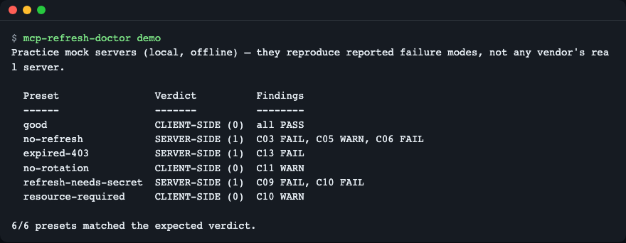
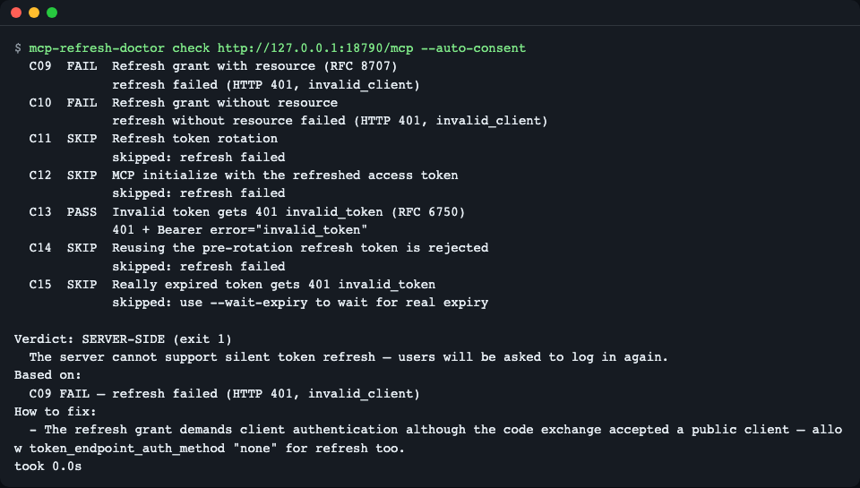
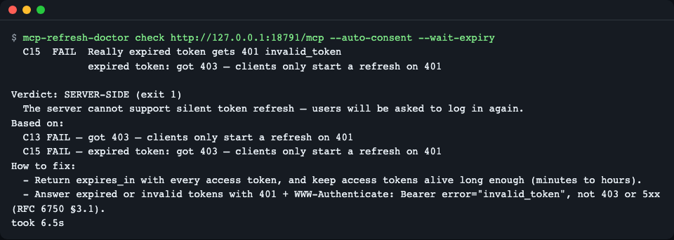
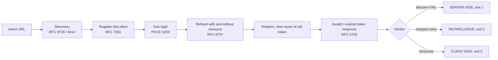

# mcp-refresh-doctor

**English** | [한국어](README.ko.md)

Find out why a remote MCP server keeps asking users to log in again. `mcp-refresh-doctor` really runs the OAuth 2.1 token lifecycle (issue, refresh, rotation, reuse, expiry) against the server and tells you whether the cause is on the server side or on the client side. It is a TypeScript CLI with zero runtime dependencies.


*`demo` checks six practice mock servers offline, each with one deliberate fault, and prints the verdict for each.*

## Who it is for
- You run a remote MCP server and users complain about "please log in again" every hour or every day.
- You do support for such a server and need evidence (a JSON report) to attach to a bug report.
- You write an MCP client and want fault-injecting fake servers to test your refresh handling offline.

## Install

Prerequisites: Node.js 20 or newer and git (`brew install node git`, or `apt-get install -y nodejs npm git` on Debian/Ubuntu; check that `node --version` prints v20+).

```bash
git clone https://github.com/LeeGyeongPil/mcp-refresh-doctor.git
cd mcp-refresh-doctor
npm ci
npm run build
```

The commands below use `node dist/cli.js`. After `npm link` (or once installed from a registry) the same thing is `mcp-refresh-doctor`.

## Quick start

No server and no network needed. This starts six practice mock servers on 127.0.0.1 and checks each one:

```bash
node dist/cli.js demo
```

```
Practice mock servers (local, offline) — they reproduce reported failure modes, not any vendor's real server.

  Preset                Verdict          Findings
  ------                -------          --------
  good                  CLIENT-SIDE (0)  all PASS
  no-refresh            SERVER-SIDE (1)  C03 FAIL, C05 WARN, C06 FAIL
  expired-403           SERVER-SIDE (1)  C13 FAIL
  no-rotation           CLIENT-SIDE (0)  C11 WARN
  refresh-needs-secret  SERVER-SIDE (1)  C09 FAIL, C10 FAIL
  resource-required     CLIENT-SIDE (0)  C10 WARN

6/6 presets matched the expected verdict.
```

How to read it: **SERVER-SIDE** means the server breaks silent refresh, so users must log in again. **CLIENT-SIDE** means the server passed every decisive check, so the repeated login most likely comes from the client (it does not store the rotated refresh token, forgets `resource`, and so on). The `C..` ids are individual checks, listed in [Checks](#checks).

These practice servers are mock servers I wrote to reproduce reported failure modes. They are not any vendor's real server.

## Usage

| Command / option | What it does | Example |
|---|---|---|
| `check <mcp-url>` | Logs in once (one browser login), then runs checks C01 to C14 | `node dist/cli.js check https://mcp.example.com/mcp` |
| `--auto-consent` | Follows the authorize redirect without a browser (loopback test servers only) | `check http://127.0.0.1:8787/mcp --auto-consent` |
| `--wait-expiry` | Also waits until the access token really expires and checks the response (C15) | `check ... --wait-expiry --max-wait 3700` |
| `--client-id <id> --redirect-port <n>` | Use a pre-registered public client instead of dynamic registration | |
| `--scope`, `--timeout <sec>`, `--allow-http` | Override scope, per-request timeout, allow plain http to non-loopback hosts (not recommended) | |
| `--json`, `--out <file>` | Print or save the JSON report | `check ... --json` |
| `serve --preset <name>` | Start a practice mock server on 127.0.0.1 (`--port`, `--ttl`) | `serve --preset expired-403 --ttl 5` |
| `demo [--json]` | Check all six presets offline | `node dist/cli.js demo --json` |
| `--lang en\|ko`, `-h`, `-v` | Output language, help, version | `node dist/cli.js --version` prints `0.1.0` |

Exit codes: `0` server is refresh-ready (client-side cause), `1` server-side cause found, `2` inconclusive or usage error.

### Scenario 1: the server cannot refresh

Start a practice server in one terminal and check it from another. If the port is taken, pick another `--port` and use the port `serve` prints in the `check` URL:

```bash
node dist/cli.js serve --preset refresh-needs-secret --port 18787
node dist/cli.js check http://127.0.0.1:18787/mcp --auto-consent
```


*The code exchange works, but the refresh grant answers `invalid_client`, so the verdict is server-side.*

Excerpt of the real output (exit code 1):

```
  C09  FAIL  Refresh grant with resource (RFC 8707)
             refresh failed (HTTP 401, invalid_client)
  C10  FAIL  Refresh grant without resource
             refresh without resource failed (HTTP 401, invalid_client)
  ...
Verdict: SERVER-SIDE (exit 1)
  The server cannot support silent token refresh — users will be asked to log in again.
Based on:
  C09 FAIL — refresh failed (HTTP 401, invalid_client)
How to fix:
  - The refresh grant demands client authentication although the code exchange accepted a public client — allow token_endpoint_auth_method "none" for refresh too.
```

### Scenario 2: expired tokens answered with 403

Clients start a refresh only when they get `401` with `error="invalid_token"` (RFC 6750). A `403` makes them give up and ask the user to log in again.

```bash
node dist/cli.js serve --preset expired-403 --ttl 5 --port 18791
node dist/cli.js check http://127.0.0.1:18791/mcp --auto-consent --wait-expiry
```


*`--wait-expiry` waits for the real expiry (about 7 seconds here) and sees HTTP 403 instead of 401.*

```
  C15  FAIL  Really expired token gets 401 invalid_token
             expired token: got 403 — clients only start a refresh on 401

Verdict: SERVER-SIDE (exit 1)
Based on:
  C13 FAIL — got 403 — clients only start a refresh on 401
  C15 FAIL — expired token: got 403 — clients only start a refresh on 401
How to fix:
  - Return expires_in with every access token, and keep access tokens alive long enough (minutes to hours).
  - Answer expired or invalid tokens with 401 + WWW-Authenticate: Bearer error="invalid_token", not 403 or 5xx (RFC 6750 §3.1).
```

### Scenario 3: a real remote server

```bash
node dist/cli.js check https://your-server.example.com/mcp --out report.json
```

The tool prints a login URL (and tries to open your browser). Approve once; it then runs the lifecycle with a separate test client it registers itself, so your real client's tokens are not touched. Attach `report.json` to a bug report. Plain `http://` to non-loopback hosts is refused:

```
error: refusing plain http for non-loopback host (use --allow-http)
```

Note: the browser-login path against third-party servers could not be exercised in my build environment; it uses the same engine that the practice servers test.

## Checks

`check` prints these 15 checks with the same titles. In the last column, **S** means a FAIL decides SERVER-SIDE (exit 1); the other checks only add a WARN or FAIL finding with a fix hint. A check that cannot run is shown as SKIP.

| Id | What is tested | Standard | Decides |
|---|---|---|---|
| C01 | An unauthenticated request gets 401 with a Bearer `WWW-Authenticate` (and `resource_metadata`) | RFC 9728 §5.1, RFC 6750 | |
| C02 | Protected resource metadata is served; `offline_access` must not be listed there | RFC 9728, SEP-2207 | |
| C03 | The auth server advertises the `refresh_token` grant | RFC 8414 | S |
| C04 | The auth server lists `offline_access` in its own metadata (only there) | SEP-2207 | |
| C05 | Dynamic registration keeps `refresh_token` in the granted grant types | RFC 7591 | |
| C06 | The code exchange (PKCE S256) issues a refresh token | OAuth 2.1, RFC 7636 | S |
| C07 | The access token response carries `expires_in` | RFC 6749 §5.1 | |
| C08 | MCP `initialize` works with the first access token | MCP authorization | S |
| C09 | Refresh grant with the `resource` parameter succeeds | RFC 8707 | S |
| C10 | Refresh grant without `resource` succeeds (WARN if the server requires it: clients that omit it fail) | RFC 8707 | |
| C11 | The refresh token is rotated on use (WARN if not, for public clients) | OAuth 2.1 §4.3.1 | |
| C12 | MCP `initialize` works with the refreshed access token | MCP authorization | S |
| C13 | An invalid token gets 401 `invalid_token`, not 403 or 5xx | RFC 6750 §3.1 | S |
| C14 | Reusing the pre-rotation refresh token is rejected (`invalid_grant`). Runs last: a compliant server then revokes the test client's token family | OAuth 2.1, RFC 6749 §5.2 | |
| C15 | A really expired token gets 401 `invalid_token`. Runs only with `--wait-expiry` | RFC 6750 §3.1 | S |

Inconclusive (exit 2) is separate: discovery, registration or login stopped, so nothing was proven.

## Settings

| Setting | Meaning |
|---|---|
| `--lang en\|ko` | Output language. Highest priority |
| `MCP_REFRESH_DOCTOR_LANG` | `en` or `ko`. Used when `--lang` is not given |
| `LC_ALL`, `LC_MESSAGES`, `LANG` | Fallback; a value starting with `ko` gives Korean, anything else English |

No API keys are needed. Mock mode (`serve`, `demo`) is a rehearsal environment: it is fast and deterministic, while a real server may be slow and depends on its own policies.

## How it works



1. Discovery reads the protected-resource and authorization-server metadata.
2. A separate test client is registered, so real users are not affected.
3. One login gives the first access and refresh tokens.
4. Refresh is tried with and without the `resource` parameter, then rotation is checked.
5. The reuse test runs last: a compliant server revokes every refresh token issued from that grant when an old one returns.
6. A fixed rule table turns the check results into a verdict. The same input always gives the same output. FAIL in C03, C06, C08, C09, C12, C13 or C15 means server-side; stopping at discovery, registration or login means inconclusive.

## When to use it
- Good fit: a remote MCP server where users are asked to log in again and you want to know which side is at fault, with evidence.
- Other tools: to inspect a server's tools and calls interactively use the [MCP Inspector](https://github.com/modelcontextprotocol/inspector); to build the OAuth client itself use an OAuth library such as [oauth4webapi](https://github.com/panva/oauth4webapi). This tool only diagnoses the refresh lifecycle.

| Tool | What it does about refresh, rotation, reuse and expiry |
|---|---|
| This tool | Runs all four against a server and reports PASS/WARN/FAIL with a verdict |
| [MCP Inspector](https://github.com/modelcontextprotocol/inspector) 2.16.0 | Refreshes as a client (`--use-stored-auth`), but does not judge rotation, reuse, expired-token responses or metadata |
| Postman MCP OAuth debugger | Shows the login flow up to an authenticated request; no refresh, rotation or expiry step |
| [mcp-oauth-compliance](https://www.npmjs.com/package/mcp-oauth-compliance) 0.2.1 | Static compliance checks; none for the refresh grant, rotation, reuse, expired 401 or `offline_access` |

(Read from each tool's public docs on 2026-11-24. These tools change, so check their pages.)

## Safety
- The tool registers its own test client, so your real client's tokens are not touched.
- Tokens, codes and `client_id` are kept in memory and masked in reports and logs. The one exception is the login URL printed for you to open, which shows the test `client_id` in full.
- C14 (reuse) revokes the test client's token family on compliant servers, never your real client's.
- `serve` and the login callback listen on 127.0.0.1 only. `check` refuses plain `http://` to other hosts unless `--allow-http`.
- HTTP response bodies are read with a 1 MB cap.

## Limitations and roadmap
- Public clients only (M1): no client secret, DPoP or private_key_jwt (planned), no Client ID Metadata Documents (planned); servers that only register confidential clients end as inconclusive.
- A browserless recheck of a saved login is planned, not built.
- The browser-login path against third-party servers was not exercised in the build environment.
- `--wait-expiry` waits for the full access-token lifetime (bounded by `--max-wait`, default 3700 s).
- The practice presets are mocks of reported faults, not real vendor servers.

## Troubleshooting

| Symptom | Cause | Fix |
|---|---|---|
| `Verdict: INCONCLUSIVE` and `Stopped at discovery` | Wrong URL, no network, or the endpoint answers 200 without a token | Check the URL; the endpoint must answer 401 with a Bearer challenge |
| `error: refusing plain http ...`, exit 2 | Plain http to a non-loopback host | Use https, or `--allow-http` if you accept the risk |
| `check` waits for a long time | Waiting for the browser login | Open the printed URL and approve; it times out to inconclusive |
| `--wait-expiry` is slow | It waits for the full access-token lifetime | Lower the server's `--ttl` (practice servers) or set `--max-wait` |
| Port already in use for `serve` | Another process on that port | Use another `--port`, or `--port 0` for a random one |

## Development

```bash
npm test
```

Runs the build and 64 tests (random 127.0.0.1 ports only, no network or keys). Bugs and ideas are welcome as issues. Changes are listed in [CHANGELOG.md](CHANGELOG.md).

## License

MIT.
